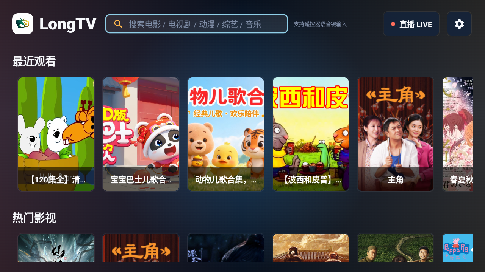
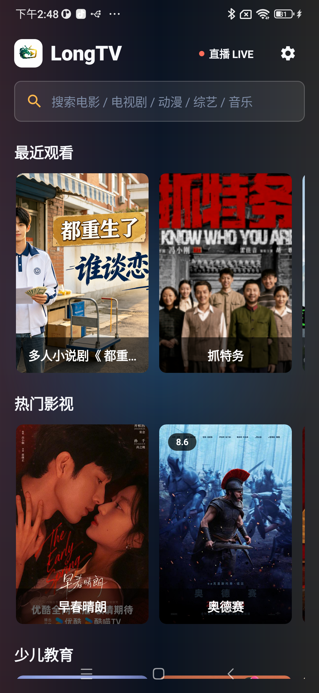

# LongTV

LongTV 是一个个人自用的影视盒子 App，也是我借助 AI 尝试 Jetpack Compose 的实践项目，用来体验 Compose 在 TV 端和手机端界面开发中的实际效果。

这个项目主要面向私人使用和技术探索，不是公开影视服务、内容分发平台或商业产品。项目中的配置、数据源与媒体访问方式仅用于个人场景，使用时应遵守相关法律法规以及内容来源的授权要求。

## 首页预览

### TV 端



### 手机端



## 项目目标

- 通过真实 App 实践 Jetpack Compose 的页面搭建、状态管理和多端 UI 组织方式。
- 探索 Android TV 遥控器焦点、横屏布局和大屏交互体验。
- 同时适配手机端触控界面，沉淀 TV / Phone 共用的业务能力。
- 了解影视盒子常见能力，包括首页推荐、搜索、详情、收藏、历史、直播和播放。
- 作为个人实践项目，尝试让 AI 参与需求拆解、代码实现、调试和迭代。

## 当前功能

- TV 端和手机端双端首页。
- 影视搜索、热门影视、最近观看、收藏和历史记录。
- 直播入口和播放能力。
- 少儿教育、课堂教育、听书、音乐演唱会等内容分区。
- 自定义数据源配置和本地缓存。
- 基于 Media3 / ExoPlayer 的视频播放。

## 技术栈

- Kotlin
- Jetpack Compose
- Android TV Compose
- Hilt
- Room
- Paging
- Coil
- Media3 / ExoPlayer
- Gradle Kotlin DSL

## 构建

项目需要本地 Android SDK 环境，并在 `local.properties` 中配置 `sdk.dir`。

调试构建：

```bash
./gradlew :app:assembleDebug
```

Release 构建：

```bash
./gradlew :app:assembleRelease
```

如果需要生成已签名 release APK，请在本地准备 `key.properties` 和对应 keystore。`key.properties`、`local.properties`、构建产物等本地文件不会提交到仓库。

## 说明

LongTV 仅作为个人尝试 Jetpack Compose 的实践项目维护。项目代码会随着实践过程持续调整，功能和结构可能随时变化。
